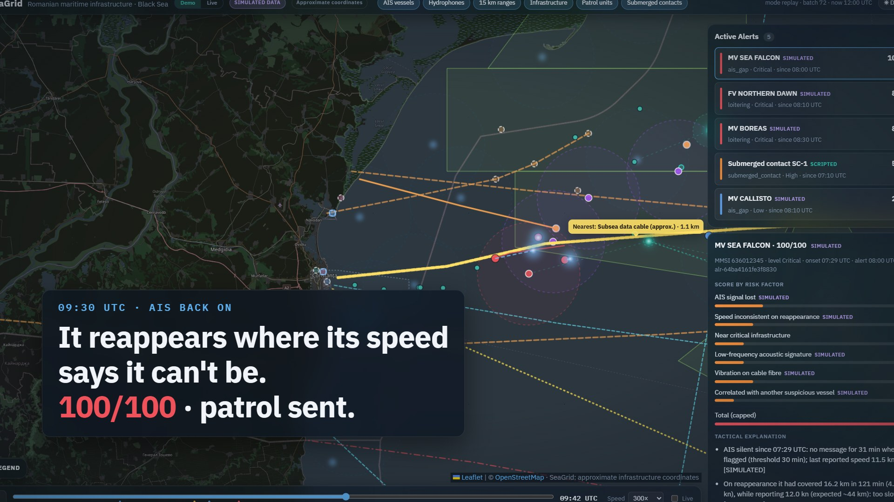
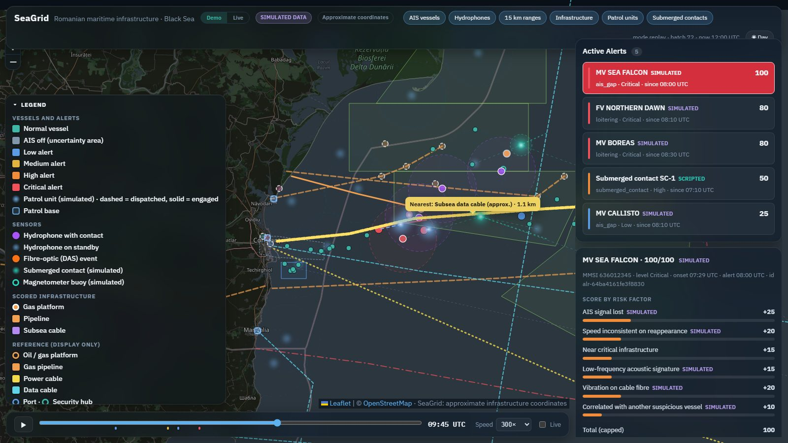
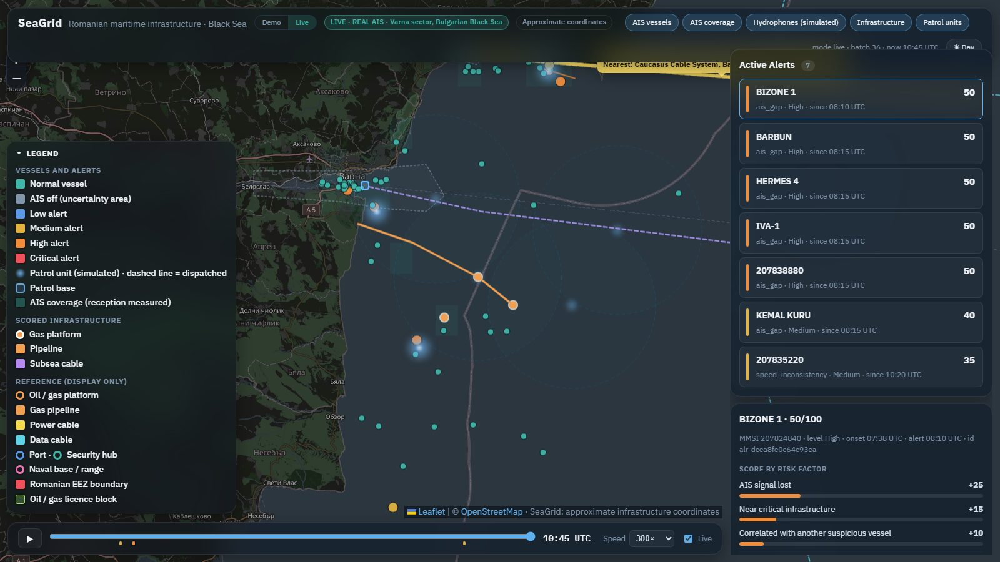
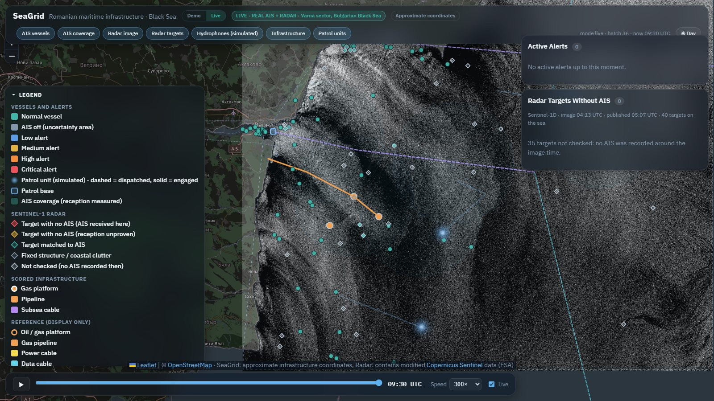
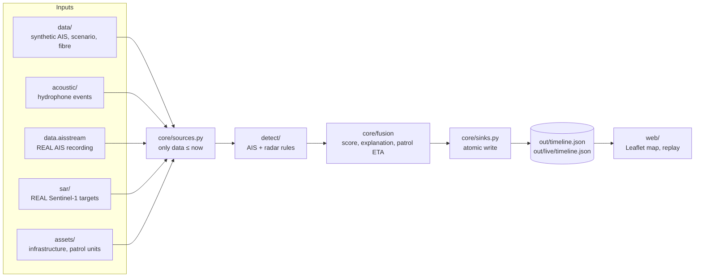

# SeaGrid

**Watching over Romania's critical maritime infrastructure in the Black Sea.**

SeaGrid follows ships around gas platforms, pipelines, subsea cables and the approach to the port of Constanța.
It spots behaviour that does not add up: a ship that goes silent, one that reappears too far away, one that loiters
above a cable, or a radar return with no AIS at all. It then raises an alert with a risk score, a plain-English
explanation and the nearest patrol unit, with its ETA.

[](pitch/brag/brag.mp4)
<sub>50-second launch video, with music ([`pitch/brag/brag.mp4`](pitch/brag/brag.mp4)).</sub>

| | |
|---|---|
| **Demo** | A scripted, fully SIMULATED scenario off Constanța: replay it with a time slider and watch the score build up factor by factor. |
| **Live** | REAL ship traffic (AIS) recorded from aisstream.io around Varna, analysed on the wall clock by the same rules. |
| **Radar** | REAL Sentinel-1 satellite images: ships are found on each pass and cross-checked with AIS. A ship on the radar with no AIS is a dark vessel. |

> Everything simulated is labelled **SIMULATED** in the data and on screen. Infrastructure coordinates are approximate.
> Patrol units are always fictitious. Explanations come from fixed templates filled with the detector's numbers, not from an AI.

---

## What it looks like

**Demo:** the cargo ship MV SEA FALCON switches AIS off near a gas platform and a data cable. A fishing boat loiters
nearby, a hydrophone hears a low-frequency engine, the cable's fibre feels a vibration. The alert reaches 100/100 and
a patrol vessel is sent.



**Live:** real ships off Varna. Each alert lists its factors and a recommended unit. **Acknowledge & engage**
records the operator's decision, and **Copy tasking** copies a ready-to-send order.



**Radar:** a real Sentinel-1 pass over Varna, with every vessel-sized target colour-coded by what the AIS
cross-check made of it.



---

## What counts as suspicious

| Signal | Rule | Points |
|---|---|---|
| AIS signal lost | silent for more than 30 min (`now - last message`), where AIS is actually received | 25 |
| Speed inconsistent on reappearance | the distance covered during the silence does not match the reported speed (too fast **or** too slow) | 20 |
| Loitering | low speed and tightly clustered positions, outside ports and anchorages | 20 |
| Position jump | physically impossible move between two reports | 20 |
| Rendezvous | two ships slow and close together at sea (ship-to-ship transfer) | 25 |
| Identity spoofing | the same MMSI in two places at once | 30 |
| Radar: dark target | a ship-sized radar return with no AIS, where AIS is received | 35 |
| Radar: confirms a silent ship | a radar target inside the area where a silent ship could be | 40 |
| Acoustic / fibre (demo) | low-frequency signature on a hydrophone, vibration on the cable fibre | 15 / 20 |
| Context | near critical infrastructure, another suspicious ship close by | 15 / 10 |

Points add up to a 0–100 score (levels low, medium, high, critical). Every threshold and point value lives in
[`config.yaml`](config.yaml). On real data the rules also learn where AIS is received and where ships anchor,
and they ignore a 2 km buffer around the coast, so a ship leaving radio range or waiting in port is not an alert.

### Evaluation (held-out seed, SIMULATED data)

| Anomalies | Detected | Detection rate | False alarms | Mean time to alert |
|---|---|---|---|---|
| 8 | 8 | **100%** | **0** | 20.5 min |

Thresholds are tuned only on seed 42 and reported on seed 1337. Full table: [`pitch/metrics.md`](pitch/metrics.md).

---

## Quick start

Python 3.11 or newer. Versions in `requirements.txt` are pinned and have wheels for 3.11–3.14.

```bash
python -m venv .venv
# Windows (PowerShell): .\.venv\Scripts\Activate.ps1   Linux/macOS: source .venv/bin/activate
python -m devtools.bootstrap        # = make setup: dependencies + git hooks
python -m core.demo                 # = make demo: writes out/timeline.json
python -m http.server 8000          # = make serve
# open http://localhost:8000/web/ and press ▶
```

> **Windows:** if PowerShell refuses to run `Activate.ps1`, run
> `Set-ExecutionPolicy -Scope CurrentUser RemoteSigned` once, or skip activation and call `.venv\Scripts\python.exe -m ...`.

Tip: `http://localhost:8000/web/?at=2026-03-15T09:45:00Z` opens the demo at its critical alert.

### Live mode on REAL AIS

1. Copy `.env.example` to `.env` and put your free aisstream.io key in it (https://aisstream.io, sign in with GitHub,
   "API Keys"). `.env` is never committed.
2. The area is `live.area` in `config.yaml` (or the `SEAGRID_AREA` environment variable). **aisstream.io has no
   receiver near Constanța**, so the default is `varna`.
3. Run, each in its own terminal:
   ```bash
   python -m data.aisstream     # = make record: keeps recording into data/raw/ais/<area>/
   python -m core.live          # = make live: rewrites out/live/timeline.json every minute
   python -m sar.process --watch   # = make radar (optional): processes each new Sentinel-1 pass
   python -m http.server 8000   # open http://localhost:8000/web/?mode=live, or click "Live" in the header
   ```

Live mode writes its own file, so running the demo never replaces it. The **Demo / Live** switch in the page
header picks which one you see. A useful coverage map needs a few hours of recording.
`python -m core.live --at <ISO time>` replays one moment of an existing recording.

Sentinel-1 passes over the area come about twice a day and are read from Microsoft Planetary Computer (no account).
Recordings and radar images stay in `data/raw/` and are never committed.

---

## How it works



- The pipeline runs in micro-batches on a clock and never reads anything newer than `now`.
- Every alert and event has a deterministic id, so reruns never duplicate.
- Distances are haversine, never flat lat/lon.
- `web/` only displays. No detection, scoring or thresholds in the browser.
- No server, database, Docker or cloud. A live server with WebSockets would change only `core/sources.py`,
  `core/sinks.py` and `web/loader.js`.

## Commands

Each `make` target is a thin wrapper around a `python -m` command. Without `make`, run the middle column.

| make | direct command | what it does |
|---|---|---|
| `make setup` | `python -m devtools.bootstrap` | installs dependencies, activates `.githooks/` |
| `make test` | `python -m pytest` | all tests |
| `make demo` | `python -m core.demo` | traffic (seed 42) + scenario + acoustic + pipeline -> `out/timeline.json` |
| `make eval` | `python -m eval.evaluate --seed-set tuning --run` | metrics on the tuning seed |
| `make eval-report` | `python -m eval.evaluate --seed-set both --run --write-md pitch/metrics.md` | tuning + held-out |
| `make watch` | `python -m core.pipeline --watch` | micro-batches on a simulated clock (tick "Live" on the slider) |
| `make serve` | `python -m http.server 8000` | static server; the page is at `/web/` |
| `make record` | `python -m data.aisstream` | records REAL AIS (needs `.env`) |
| `make live` | `python -m core.live` | pipeline on the real recording, wall clock |
| `make radar` | `python -m sar.process --watch` | Sentinel-1 ship detection on each new pass |
| `make schema` | `python -m contracts.export_schema` | regenerates the JSON Schema |
| `make validate` | `python -m contracts.validate out/timeline.json --model Timeline` | validates the output |

## Repository map

| Directory | What is inside |
|---|---|
| [`contracts/`](contracts/) | pydantic models, JSON Schema, haversine, deterministic ids |
| [`data/`](data/) | synthetic traffic, anomaly injector, ground truth, the real AIS recorder |
| [`detect/`](detect/) | AIS rules, radar-vs-AIS cross-check, exclusion zones and port buffer |
| [`acoustic/`](acoustic/) | low-frequency hydrophone detector (demo) |
| [`sar/`](sar/) | Sentinel-1 pass catalogue, image reading, sea mask, ship detection |
| [`core/`](core/) | pipeline, fusion, score, explanations, patrol ETA, live mode |
| [`web/`](web/) | the map, alert panel, radar layer, replay |
| [`eval/`](eval/) | detection rate, false alarms, time to alert |
| [`assets/`](assets/) | infrastructure (approximate) and patrol units (fictitious), per area |
| [`pitch/`](pitch/) | presentation outline, jury questions, metrics, launch video |

Each directory has its own `README.md`. Plain-language overview: [`docs/README.md`](docs/README.md).
Working and design rules for the team (and for coding assistants): [`AGENTS.md`](AGENTS.md).

## Team workflow

Branches: `main` (always runs the demo) ← `role/<role>` ← `feat/<module>-<name>`. One feature per branch, commit at
every green step, merge into the role branch after `/verify`, into `main` only through `/integrate`.
Details: the "Git workflow" section of [AGENTS.md](AGENTS.md).

Commits are made only by humans, with the git identity configured on the machine. The `.githooks/commit-msg` hook
rejects messages that attribute authorship to an AI tool. `make setup` activates it.

## Data and credits

- AIS: [aisstream.io](https://aisstream.io) (free key, recorded locally).
- Radar: contains modified Copernicus Sentinel data (ESA), via [Microsoft Planetary Computer](https://planetarycomputer.microsoft.com).
- Coastline and map tiles: © [OpenStreetMap](https://www.openstreetmap.org/copyright) contributors. Map: [Leaflet](https://leafletjs.com).
- Built for a defence hackathon. A prototype, not an operational system.
